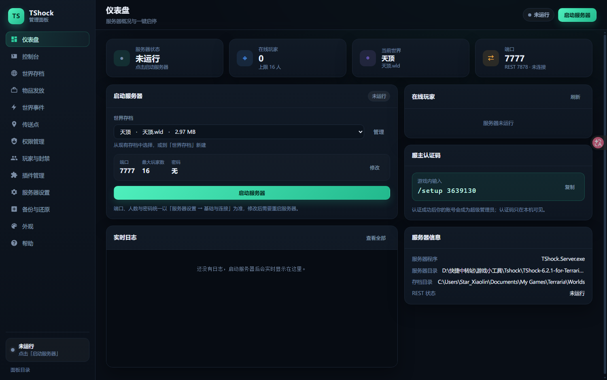

# TShock 管理面板

一个给 **泰拉瑞亚 TShock 服务器**（TShock 6.2.1 / 游戏 1.4.5.8）用的本地图形化管理工具。

启动服务器、选世界、改配置、看日志、踢人封禁、备份存档，以及**发放物品、管理用户组权限、编辑 SSC 初始物品、触发世界事件、查看在线玩家详情、管理用户账户**，都可以在浏览器里点鼠标完成。

- 零第三方依赖：只用 Node.js 内置模块，不需要联网安装东西
- 零侵入：服务器程序、存档、`tshock/config.json` 都保持原有格式，面板只是给它们套了个界面
- 只监听 `127.0.0.1`，不会把面板暴露到局域网



---

## 一、快速开始

1. 确认电脑装了 **Node.js 22 或更高版本**（命令行执行 `node -v` 能看到版本号即可）。
   「传送点」列表需要 Node 22 内置的 `node:sqlite`；更低版本其他功能仍可用，但传送点只能看到公开项。
   没装的话到 <https://nodejs.org/> 下载 LTS 版安装。
2. 双击服务器目录里的 **`启动管理面板.cmd`**。
3. 浏览器会自动打开面板地址（默认 `http://127.0.0.1:13087`；如果端口被占用会自动换成 13088、13089…，控制台窗口里会显示实际地址）。
4. 在「仪表盘」里选好世界、端口、人数，点 **启动服务器**。

> 面板窗口（黑色命令行窗口）**不要关**，关了面板就没了。
> 想完全退出时，到「服务器设置 → 面板设置」点「停止服务器并退出面板」，或者在那个窗口按 `Ctrl+C`。

---

## 二、第一次开服要做的三件事

1. **选世界**
   打开「世界存档」，直接选一个已有世界点「启动」；
   或者点「新建世界」填名称、大小、种子（种子留空就随机），生成完成后自动回到列表。

2. **进游戏拿服主权限**
   「仪表盘」右侧有个「服主认证码」。进入游戏后，在聊天框输入：

   ```
   /setup 3639130
   ```

   （把数字换成面板上显示的认证码）成功后你的账号就是超级管理员。

3. **按需调整规则**
   「服务器设置」里所有配置都有中文说明，改完点 **保存设置**，再点右上角 **重启** 生效。

---

## 三、每个页面能做什么

| 页面 | 说明 |
| --- | --- |
| **仪表盘** | 运行状态、在线人数、当前世界、端口；一键启动/停止/重启/存档；实时日志；在线玩家；服主认证码 |
| **控制台** | 完整日志流（可筛选错误、只看命令）、命令输入框、常用命令快捷键、导出日志 |
| **世界存档** | 列出所有 `.wld`（自动读取世界名、版本、大小、修改时间）；新建世界；导入 `.wld`；启动/选择/备份/删除 |
| **物品发放** | 在线玩家下拉、物品搜索（中文名 / 英文名 / 数字 ID）、数量与前缀、发放记录 |
| **世界事件** | 陨石、满月、血月、日食、沙尘暴、灯笼夜、流星雨一键触发；入侵类型 + 波数；雨的类型；最近一次结果回显 |
| **传送点** | 列出全部 `/warp`（含隐藏项）、坐标、所属世界；新建、隐藏/取消隐藏、删除、发送玩家、批量操作 |
| **权限管理** | 用户组列表、权限节点展示与勾选、父组设置、通配/反权限警告、常用权限预设 |
| **玩家与封禁** | 在线玩家详情（账户信息 / 脱敏 IP）、踢出/封禁/杀死；封禁列表与解封；账户搜索、改密码、改组、删除；白名单编辑 |
| **插件管理** | ServerPlugins 目录的 DLL 列表、上传/删除；`tshock/*.json` 插件配置编辑；可选检测 AutoPluginManager |
| **服务器设置** | 150+ 项配置的中文表单（开关、数字、下拉、颜色）；SSC 角色存档与**初始物品编辑器**；MOTD 与规则文本 |
| **备份与还原** | 手动备份、启动前自动备份；备份含世界存档 + 账号数据库 + 配置文件；一键还原；删除 |
| **外观** | 夜间 / 日间 / 高对比度三套主题、自定义配色（色板选择）、字号缩放、布局密度、图标大小、自定义主题导入导出 |
| **帮助** | 上手步骤、常见问题、各目录位置 |

> **本次修复**：仪表盘的「最大玩家数 / 端口」以前取自面板启动参数（会覆盖 `config.json`），
> 与「服务器设置」里的 `MaxSlots` / `ServerPort` 对不上。现在启动服务器不再传 `-maxplayers` / `-port`，
> 两处统一以 `tshock/config.json` 为准（运行时显示 REST 返回的实际值）。

---

## 三之二、六个扩展模块的具体行为

### 1. 物品发放

- 对应 TShock 的 `/give <物品ID或名称> <玩家> [数量] [前缀]`，所需权限 `tshock.item.give`。
- 物品库来自 Terraria 官方物品 ID 表（中文名 + 英文名 + 内部名，共 6195 条），另加 3 个起始装备负数 ID
  （`-15` 铜短剑、`-13` 铜镐、`-16` 铜斧），离线可用，放在 `TShockPanel/data/items.json`。
- 提交前依次校验：物品 ID 是否存在 → 数量是否在 1–9999 → 前缀是否在 0–255 → 目标玩家是否在线；
  全部通过后才把指令交给 TShock，由 TShock 再做一次物品/前缀校验并实际发放。
- 搜索框同时匹配 `天顶剑`、`Zenith`、`4956` 三种输入。

### 2. 权限管理

- 组列表与权限都来自 TShock（`/v2/groups/list`、`/v2/groups/read`），没有硬编码任何组名。
- 勾选/取消 = `/group addperm` / `/group delperm`，父组 = `/group parent`，与命令语义完全一致。
- 权限节点目录取自 TShockAPI.dll 里的 179 个真实节点，按“物品 / 世界事件 / 世界与时间 / 账号 / 管理与封禁 / 传送 / NPC / 玩家状态 / 反作弊豁免 / REST”分类。
- 输入或已存在 `*`（通配）或 `!`（反权限）时会弹出确认并标红提示；
  列表里只显示该组“自身”的权限，继承来的权限不会列出（也无法在子组里删除）。

### 3. 玩家初始物品（SSC StartingInventory）

- 位于「服务器设置 → 角色存档（SSC）」，只在 `sscconfig.json` 的 `StartingInventory` 上做增删改，
  保存时只替换这一个字段，`StartingHealth`、`StartingMana` 等其它配置原样保留，写入前自动备份。
- 每行可搜索物品、填 `prefix`（0–255）与 `stack`（1–9999）；`netID` 允许 0（空槽位）和负数（起始装备）。
- 顶部会提示当前是否启用 SSC；启用后**初始物品会覆盖客户端本地初始物品**，只影响之后新建的角色。

### 4. 世界事件

- 事件类型、入侵类型、雨的类型**在运行时从 `/worldevent`、`/worldevent invasion`、`/worldevent rain` 的帮助输出解析**，
  TShock 升级后新增的事件会自动出现在界面上，不是写死的清单。
- 本机 TShock 6.2.1 实际支持：`meteor, fullmoon, bloodmoon, eclipse, invasion, sandstorm, rain, lanternsnight, meteorshower`；
  入侵类型 `goblins, snowmen, pirates, pumpkinmoon, frostmoon, martians`；雨的类型 `slime, coin`。
- 每个事件都会显示它需要的权限节点（`tshock.world.events.<类型>`），触发前用 `/v3/world/bloodmoon` 读取当前血月状态做冲突预判：
  血月进行中再触发日食会弹出“互斥”确认框；TShock 自己返回的错误（例如“正在下雨时不能开启史莱姆雨”）会原样显示在结果面板里。
- 触发结果（成功/失败 + 原始返回行）会留在「最近一次操作」里。

### 5. 玩家监控

- 在线列表来自 `/v2/players/list`；点「详情」会显示角色名、账号、权限组、IP（默认脱敏）以及
  `/accountinfo` 返回的注册时间、最后记录 IP。
- 查看完整 IP 需要再点一次按钮，属于单独的高权限动作，会在控制台写入一条审计日志。
- 选中玩家后可以踢出 / 封禁 / 杀死（沿用已有接口）。
- **SSC 背包快照暂不可用**：当前 TShock 没有提供读取 SSC 背包的公开接口，界面会如实提示，而不是去读数据库。

### 6. 用户账户

- 列表来自 `/v2/users/list`，支持按名字搜索；创建用 `/user add` 的等价接口，删除前二次确认并提示不可逆。
- 改密码、改组都走 TShock 的账户接口（`/v2/users/update`），组变更后内存里的玩家组会同步更新。
- 密码只用掩码输入框收集，直接传给 TShock 的账户接口，**不写日志、不回显、不落盘**。
- 目标组下拉从 TShock 的组列表动态读取；**禁止直接把账户设为 `superadmin`**，界面会提示改为自定义管理组。

### 7. 传送点（Warp）

- **权限是全局的**：`tshock.admin.warp` 管理、`tshock.warp` 使用、`tshock.tp.others` 发送他人。
  TShock 没有“单个传送点独立权限节点”这种机制，面板也不会假装支持。
- **列出**：TShock 的 `/warp list` 不显示隐藏项，所以面板用 Node 22 内置的 `node:sqlite`
  **只读**读取 `tshock.sqlite` 的 `Warps` 表（`WarpName` / `X` / `Y` / `WorldID` / `Private`），
  因此隐藏的传送点也能看到并标注状态。传送点按世界 ID 隔离，列表会标出哪些属于当前世界。
- **隐藏 / 取消隐藏 / 删除**：走 `/warp hide [名称] <true|false>`、`/warp del [名称]`，
  保证 TShock 内存里的缓存同步；如果是面板刚插入、TShock 还没加载的条目，会自动回退为直接写库。
- **发送玩家**：`/warp send [角色名] [传送点名]`，需要目标玩家在线。
- **新建**：TShock 只支持 `/warp add <名字>`（位置取执行者坐标，控制台即出生点），无法指定坐标。
  所以面板是直接往 `Warps` 表插入一行（写入前备份数据库），并明确提示
  **需要重启服务器**才会被 TShock 加载——因为 TShock 在启动时把传送点读进内存。
- 批量隐藏 / 取消隐藏 / 删除都有二次确认。

### 8. 插件管理（Plugin）

- **TShock 没有热重载/卸载单个插件的 API**：插件 DLL 在服务器启动时加载，
  禁用、卸载、新增都需要重启。面板只做文件层面的管理，不会调用不存在的 `TShock.Plugins.*`。
- **插件文件**：扫描 `ServerPlugins/*.dll`，显示文件名/大小/修改时间，支持上传与删除
  （删除进 `trash/`，覆盖上传前会备份旧文件），操作后明确提示“重启服务器后生效”。
- **插件配置**：扫描 `tshock/*.json`，排除 `config.json`、`sscconfig.json`，
  用 JSON 编辑器打开，保存前校验 JSON 并备份原文件。
- **AutoPluginManager（可选）**：只有探测到 `/apm` 命令确实存在时才显示对应卡片，
  `/apm -il` 看列表、`/apm -on|off [序号]` 启停；探测不到就隐藏并说明原因。
- 顶部会根据“插件文件的修改时间是否晚于服务器启动时间”提示是否有未生效的变更。

### 9. 界面主题（Theme）

- 所有颜色、字体、圆角、间距、控件高度都收敛为 `style.css` 顶部的设计令牌，业务样式里不再出现硬编码颜色。
- 三套内置主题（夜间 / 日间 / 高对比度）都为**全部令牌**提供值，不存在“缺了就用默认色”的兜底。
  正文对比度：夜间 15:1、日间 17.9:1、高对比度 21:1（高对比度达到 WCAG AAA）。
- 切换主题立刻生效，只写 `TShockPanel/dsh.ui.json`，**不会请求 TShock、不会刷新玩家列表**，
  也不会碰 `tshock/` 下的任何文件。
- 字号缩放 90%–125%、布局密度（舒适/紧凑）、侧边栏图标大小、是否显示按钮文字，都会持久化。
- **自定义配色**：在「外观 → 自定义配色」里直接选颜色（页面背景、卡片、文字、主色、
  边框、输入框、危险/警告/成功），选的时候就能实时预览，点「应用配色」才写入
  `dsh.ui.json`；它会生成一个「自定义」主题卡片（第四个），可随时切回其它主题。
  主色会连带派生悬停色、深色、文字色与选区色，不会出现“紫色主色 + 绿色按钮”。
  底层主题可自定义（默认以当前主题为底），所以既能做浅色变体也能做深色变体。
- 支持导出当前主题为 JSON、导入自定义主题：导入时逐项校验所有令牌与颜色格式，
  缺项或非法会直接报错并保持原主题，不会静默套用默认值。

---

## 四、几个实用细节

**搜索下拉不会被卡片挡住**
物品搜索的候选列表渲染在 `body` 上的浮层（`#dropdown-layer`，`position: fixed`），
不受卡片 `overflow: hidden` 裁切，也不会被下面的「原始 JSON」等卡片盖住；
滚动页面时会跟随输入框重新定位，按 `Esc` 或点空白处关闭。

**启动前自动备份**
默认开启。每次启动服务器前，会把当前世界、`tshock.sqlite`、配置复制到 `TShockPanel/backups/`，万一改坏了可以还原。
可在「服务器设置 → 面板设置」里关掉。

**改配置不会改坏文件**
保存设置时会自动备份一份 `config.json`（放在 `backups/config/`），并且用「临时文件 + 替换」的方式写入，避免写一半断电导致配置损坏。
`motd.txt`、`rules.txt`、`whitelist.txt` 这些文本文件在保存前也会各留一份旧版本。

**公告里怎么写注册/登录提示**
「服务器设置 → 公告与规则」里点 **插入注册/登录说明**，会填入一份现成模板：
```
【注册】第一次进入服务器，输入 /register 你的密码
【登录】已有账号，输入 /login 你的密码
【改密】/password 旧密码 新密码
【规则】/rules    【命令】/help
```

保存后执行 `/reload`（或重启服务器）即可生效；玩家进服时就会看到。

**新设置项也能看到**
TShock 以后新增的配置项如果面板还没有中文说明，会出现在「其他」分组里，仍然可以修改。

**世界名为什么和文件名不一样**
面板直接解析 `.wld` 头部读取世界名，所以像 `55955707-….wld` 这种 UUID 文件名也能正确显示成「言寺全物品（旅行）」这样的名字。

**删除的世界去哪了**
不会直接删掉，会移动到 `TShockPanel/trash/`，反悔了可以手动拖回去。

---

## 五、它是怎么工作的

```
启动管理面板.cmd
   └─ node TShockPanel/server.js        本地网页服务（127.0.0.1:13087）
        ├─ 启动/停止 TShock.Server.exe   子进程，输出写入 TShockPanel/logs/server-*.log
        ├─ 读取 tshock/config.json       表单展示与保存
        ├─ 解析 .wld 头部                世界名、种子、版本
        └─ 调用 TShock REST 接口         在线玩家、封禁、账号、控制台命令
```

**为什么命令要走 REST？**
TShock 在没有真实终端（TTY）时不会读取标准输入，所以没法直接往进程里写命令。
面板启动服务器时会自动在 `tshock/config.json` 里打开 REST 接口（默认端口 `7878`）并写入一个本地令牌，
之后通过 `http://127.0.0.1:7878/v3/server/rawcmd` 下发命令、通过 `/v2/players/list` 之类接口读取数据。

**为什么不是 C# 插件（TSPlayer / Group / UserAccount）**
本项目的实现语言是 Node.js，不是 C#；而且这台机器上没有 .NET SDK（只有运行时），
无法编译 TShock 插件。因此面板不自己实现 TShock 的规则，而是：

| 需求 | 本项目的做法 |
| --- | --- |
| 发物品 | 校验后把 `/give` 交给 TShock 自己执行（物品、前缀、权限仍由 TShock 判定） |
| 改组权限 | 调 `/group addperm`、`/group delperm`、`/group parent`，与命令语义一致 |
| 改账户 | 调 TShock 的用户接口（等价于 `/user add`、`/user group`、`/user password`） |
| 读组/用户 | `/v2/groups/*`、`/v2/users/*`，不直接读写数据库 |
| 世界事件 | 调 `/worldevent`，类型清单从运行时帮助输出解析 |
| 初始物品 | 直接改 `sscconfig.json` 的 `StartingInventory`（唯一无法通过接口完成的部分） |

所有命令都由 TShock 以面板令牌对应的身份执行，权限判断、物品校验都在 TShock 内部完成，面板没有复制一套规则。
如果你确实需要“C# 插件形态”（在游戏进程内调用 `TSPlayer.GiveItem`、`TShock.Groups` 等类型），
需要先安装 .NET 9 SDK，我可以在这个仓库里再补一个 `TShockPanel.Plugin` 项目，让面板通过插件接口调用。

**关于 REST 端口**
REST 会监听在所有网卡上。令牌保存在 `TShockPanel/panel.json`，请不要把这个文件发给别人。
另外服务器密码会以明文保存在同一个文件的 `launch.password` 里，面板目录不要放公共位置。
如果只想自己玩，可以在「面板设置」里改成一个不常用的端口。

**关闭面板后服务器会怎样**
面板会尽量让服务器独立于自己运行：重新打开面板时会自动接管仍在运行的服务器（显示为已连接）。
但如果你是从这个命令行窗口直接关窗口，Windows 可能连子进程一起结束。
**最稳妥的做法**：先在面板里「停止服务器」，再关闭窗口。

---

## 六、常见问题

**浏览器提示无法访问**
看面板那个黑色窗口是否还开着、里面显示的端口是多少。也可以在窗口里按 `Ctrl+C` 后重新双击启动。

**双击 `启动管理面板.cmd` 一闪而过**
多半是没装 Node.js，窗口里会提示。装好后重新双击。

**朋友连不上服务器**
依次检查：服务器是否在运行、端口和面板上写的是否一致、Windows 防火墙是否放行 `TShock.Server.exe`、外网联机是否在路由器上做了端口转发。

**新建世界失败，提示「栈溢出」**
这是 TShock 在某些世界种子下生成地形时的崩溃（与面板无关）。换一个种子，或把世界尺寸改小一点再试。

**改了设置没生效**
大部分设置需要重启服务器才会重新读取。保存后点右上角「重启」。

**端口被占用 / 服务器起不来**
换一个端口（例如 7778），或者在控制台看看是不是上一次的服务器还没退干净。

**想彻底移除面板**
删除 `TShockPanel` 文件夹和 `启动管理面板.cmd` 即可。
`tshock/config.json` 里的 `RestApiEnabled`、`RestApiPort`、`ApplicationRestTokens` 会保留，不影响正常开服；想恢复原样手动改回去即可。

---

## 七、目录说明

```
TShock-…-Release/
├─ 启动管理面板.cmd          双击启动
├─ TShock.Server.exe         泰拉瑞亚 TShock 服务器（原样未改）
├─ tshock/                   服务器配置、数据库、日志（原样未改）
├─ docs/                     重构日志与验证清单（维护者用）
├─ tools/                    开发期验证脚本（不参与运行）
└─ TShockPanel/              面板本体
   ├─ server.js              后端入口：装配依赖 → 建路由 → 监听端口（已无业务逻辑）
   ├─ lib/                   后端服务层（按职责分层，单向依赖：上层 → 下层）
   │  ├─ rest.js             TShock REST 客户端（URL/令牌/超时/参数编码的唯一出口）
   │  ├─ tshock-config.js    tshock/*.json 唯一读写入口（写前备份、保留未知字段）
   │  ├─ process.js          服务器进程：启停/接管/双 tail/就绪监控/自动重启
   │  ├─ state-view.js       /api/state 的响应装配（前端唯一真相来源）
   │  ├─ panel-state.js      panel.json 默认值/合并/令牌生成/保存
   │  ├─ http-utils.js       json / readBody / readJsonBody / requireRunning
   │  ├─ listen.js           端口顺延（被占用时 13088、13089…）
   │  ├─ items.js            物品库与发放参数校验
   │  ├─ logbus.js           日志缓冲、折叠、SSE 广播、行解析
   │  ├─ backups.js          备份创建/列表/还原/删除（含还原前自动备份）
   │  ├─ worlds-store.js     世界枚举/新建/删除（含回收站）
   │  ├─ warps-db.js         tshock.sqlite 的 Warps 表访问（唯一直接读库的地方）
   │  ├─ groups.js           用户组：组详情、增删权限、父组、建组、删组
   │  ├─ players.js          显示名、IP 打码、accountinfo 解析、封禁时间换算
   │  ├─ ssc-inventory.js    SSC 初始物品逐行校验
   │  ├─ world-events.js     世界事件探测（解析中文帮助 + 5 分钟缓存）与触发
   │  ├─ ui-state.js         外观偏好读写与范围校验
   │  ├─ static-files.js     public/ 静态文件服务（含路径穿越防护）
   │  ├─ files.js            原子写、读 JSON、时间戳、建目录
   │  ├─ worlds.js           .wld 头部解析（世界名、种子、版本）
   │  ├─ schema.js           tshock/config.json 的中文说明表
   │  └─ catalog.js          179 个权限节点目录 + 世界事件中文标签/权限映射
   ├─ routers/               按域拆分的路由（只做 HTTP 形状，依赖由 server.js 注入）
   │  ├─ server-control.js   状态/日志/SSE/启停/控制台/设置/退出 10 条
   │  ├─ config.js           配置、sscconfig、motd/rules/whitelist 6 条
   │  ├─ ssc.js              SSC 初始物品 2 条
   │  ├─ items.js            物品查询与发放 2 条
   │  ├─ players.js          玩家/封禁/账户 12 条
   │  ├─ groups.js           用户组 6 条
   │  ├─ world-events.js     世界事件 2 条
   │  ├─ warps.js            传送点 5 条
   │  ├─ worlds.js           世界存档 5 条
   │  ├─ backups.js          备份 4 条
   │  ├─ plugins.js          插件管理 6 条
   │  └─ ui.js               外观偏好 2 条
   ├─ public/                网页界面（无框架、无构建，按顺序加载）
   │  ├─ index.html          页面骨架；底部按 00 → 10 → 20 → 30..42 → 90 顺序引入脚本
   │  ├─ style.css           设计令牌 + 组件样式（三套主题）
   │  └─ js/                 前端模块（经典脚本，共享全局词法作用域）
   │     ├─ 00-core.js       通用工具：DOM 选择、格式化、api()、toast、模态框
   │     ├─ 10-state.js      全部全局状态：app / dropdown / appUi / warpState
   │     ├─ 20-shell.js      外壳：refreshState / renderShell / switchView
   │     ├─ 30-dashboard.js  仪表盘：状态、启停、在线玩家
   │     ├─ 31-console.js    控制台：日志渲染、筛选、导出
   │     ├─ 32-worlds.js     世界存档
   │     ├─ 33-players.js    玩家与封禁
   │     ├─ 34-settings.js   服务器设置表单
   │     ├─ 35-ssc.js        SSC 初始物品
   │     ├─ 36-misc.js       备份与还原、帮助
   │     ├─ 37-theme.js      外观与主题
   │     ├─ 38-give-events.js 物品发放 + 世界事件 + 浮层下拉
   │     ├─ 39-warps.js      传送点
   │     ├─ 40-groups.js     权限管理
   │     ├─ 41-plugins.js    插件管理
   │     ├─ 42-actions.js    动作调度器：把 data-action 转发给下面 8 个按页分组的模块
   │     ├─ 43-actions-shell.js           动作：外壳与服务器启停
   │     ├─ 44-actions-warps.js           动作：传送点
   │     ├─ 45-actions-plugins-theme.js   动作：插件与外观
   │     ├─ 46-actions-give-events.js     动作：物品发放与世界事件
   │     ├─ 47-actions-groups-ssc.js      动作：权限组与 SSC
   │     ├─ 48-actions-settings.js        动作：服务器设置与文本
   │     ├─ 49-actions-worlds-players.js  动作：世界存档与玩家操作
   │     ├─ 50-actions-backups-misc.js    动作：备份、杂项与控制台
   │     └─ 90-boot.js       事件绑定、SSE、boot()
   ├─ data/items.json        离线物品库（6198 条：ID / 中文名 / 英文名 / 内部名）
   ├─ panel.json             面板自己的设置（端口、令牌、上次选的世界）
   ├─ dsh.ui.json            外观偏好（主题、字号、密度），与 tshock/ 完全隔离
   ├─ logs/                  服务器的控制台输出留档
   ├─ backups/               备份（含 config/ 下的配置文件快照、warps/ 的数据库快照）
   └─ trash/                 删除的世界 / 插件回收站
```

### 加新功能时改哪里

| 想做的事 | 改哪里 |
| --- | --- |
| 新增一个 TShock 接口调用 | `lib/rest.js` 已有 `get/ok/call/command`，直接调；不要自己拼 URL |
| 新增一个接口 | 在 `routers/` 对应域里加一条 `route(...)`，依赖从 ctx 注入；不要把 handler 塞回 server.js |
| 新增一个页面 | 新建 `public/js/3x-xxx.js` + 在 `index.html` 按序加一行 + 导航加 `data-action` |
| 新增一个按钮动作 | 在对应页面的动作文件（`4x-actions-*.js`）里加一个 case；`42-actions.js` 不用改 |
| 改配置读取/保存 | 只改 `lib/tshock-config.js`；写前备份和未知字段保留由它保证 |
| 改玩家/封禁展示逻辑 | `lib/players.js`（纯函数，可直接单测）；接口形状在 `routers/players.js` |
| 改用户组操作 | 命令拼装在 `lib/groups.js`，HTTP 在 `routers/groups.js` |
| 改世界事件校验 | `lib/world-events.js`；新增事件类型先看 `lib/catalog.js` 里有没有现成标签 |
| 改静态资源映射 | `lib/static-files.js`；加新扩展名改 `MIME` 表 |
| 改外观偏好字段 | `lib/ui-state.js` 的 `UI_DEFAULTS` 与 `patch()` 白名单 |
| 改主题颜色 | 只改 `public/style.css` 顶部的令牌，不要写死在业务选择器里 |
| 改进程启停行为 | `lib/process.js`（参数拼装在 `buildArgs`，启停在 `startServer`/`stopServer`） |
| 改仪表盘字段 | `lib/state-view.js`；字段改名会直接进前端，记得同步 `public/js/30-dashboard.js` |
| 改端口/令牌默认值 | `lib/panel-state.js` 的 `defaults()` |

---

面板版本 1.0.0 · 适配 TShock 6.2.1 / Terraria 1.4.5.8
